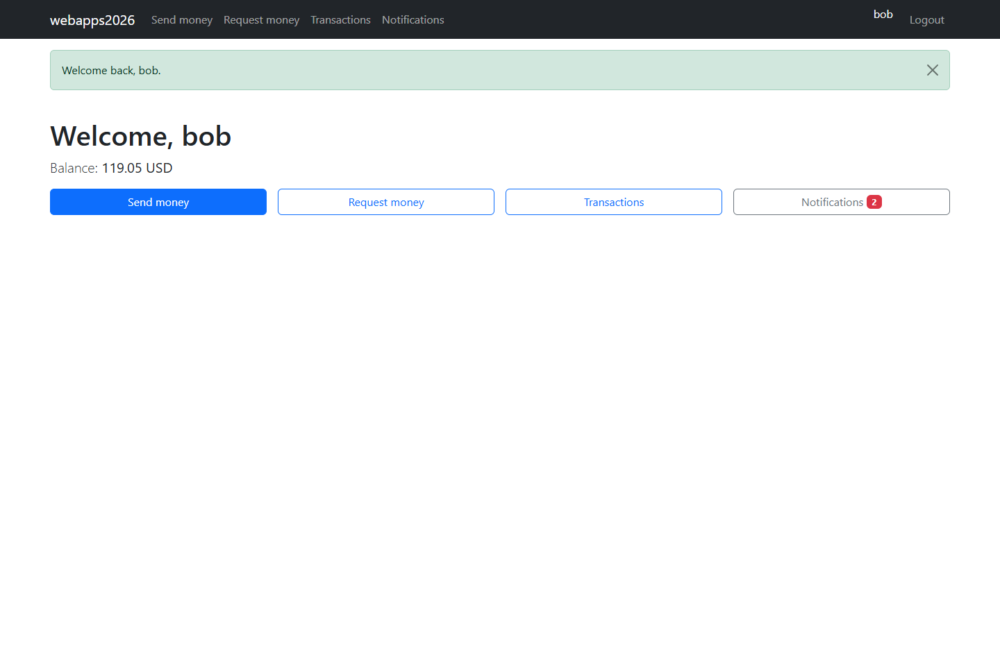

# Django Payment Simulator

A multi-user payment simulator built with Django, SQLite and a small Django REST
Framework currency-conversion service. Users can send simulated funds, request
payments, accept or decline requests, and review their own transaction history.
Staff have separate account/transaction views and can register further administrators.

**Demo money only.** There is no bank, card processor, payment gateway or connection
to real funds. Exchange rates are fixed example values, not live financial data.



## Features

- Registration, login, CSRF-protected logout and user-specific account data.
- GBP, USD and EUR accounts, with an initial balance equivalent to GBP 1,000.
- Atomic direct payments and payment-request fulfilment with balance checks.
- Notifications for incoming payments and pending requests.
- Staff-only user/transaction listings and administrator registration.
- A GET-only conversion endpoint, called over HTTP by the business-logic layer.
- Django templates with Bootstrap 5 and crispy forms; SQLite persistence.

## Quick start

Use **Python 3.12+**. From this repository's root, in PowerShell:

```powershell
py -3.12 -m venv .venv
.\.venv\Scripts\Activate.ps1
python -m pip install -r requirements.txt
$env:DJANGO_SECRET_KEY = python -c "import secrets; print(secrets.token_urlsafe(64))"
$env:DJANGO_DEBUG = '1'
python manage.py migrate
python manage.py runserver 127.0.0.1:8000
```

Open [the local application](http://127.0.0.1:8000/webapps2026/). Register two
different test users to exercise sending/requesting money. Use fictional details
and unique test email addresses. The server must remain running for cross-currency
registration/payments: those paths call its conversion endpoint over HTTP.
Do not use `runserver --nothreading` for this same-process HTTP design.

On macOS/Linux, the equivalent environment setup after activating your venv is:

```sh
export DJANGO_SECRET_KEY="$(python -c 'import secrets; print(secrets.token_urlsafe(64))')"
export DJANGO_DEBUG=1
```

The key belongs in your **local environment**, not in source control. Keep the
same key between local sessions if you want existing login sessions to remain
valid; generating a new one signs users out. `.env.example` lists the settings,
but this project does **not** automatically load `.env` files.

### First administrator

In another terminal with the same virtual environment and settings:

```sh
python manage.py createsuperuser
```

Choose your own strong password. The first visit to that user's dashboard creates
a missing account profile with **zero** balance. Registered demo users still receive
the original starting balance. Custom staff pages are under `/webapps2026/admins/`;
the pre-existing Django `/admin/` route remains enabled as well.

There is no built-in shared admin password and migrations no longer create one.
Staff can create more staff users through the application's existing form.

### Local settings

| Environment variable | Purpose |
| --- | --- |
| `DJANGO_SECRET_KEY` | Required, locally generated signing secret |
| `DJANGO_DEBUG` | `1` explicitly enables loopback HTTP development; default is off |
| `DJANGO_ALLOWED_HOSTS` | Comma-separated hostnames; defaults to localhost/127.0.0.1 |
| `INTERNAL_API_BASE` | Conversion server base URL; defaults to the local port above in debug mode |
| `INTERNAL_API_CA_BUNDLE` | Optional path to a trusted CA PEM bundle; otherwise normal TLS verification |

If using a different local port, set `INTERNAL_API_BASE` to match. Plain HTTP
conversion calls are permitted only to loopback addresses in explicit debug mode.
For HTTPS, provide a trusted certificate/CA bundle rather than disabling verification.

## Structure

```text
manage.py
webapps2026/         Settings, root URLs, WSGI and ASGI entry points
register/           Django authentication forms/views and Account model
payapp/             Payments, requests, views, forms, conversion API and HTTP helper
templates/          Existing Bootstrap-based pages and staff interface
docs/               Project refresher, change log and test results
```

The original `webapps2026` package and URL prefix are retained deliberately.
`webapps.db` is generated by migrations and excluded from Git/the upload ZIP.
It is not needed to reproduce the application and should never contain real
banking information.

### Conversion service

```text
GET /webapps2026/conversion/GBP/USD/10.00/
```

Returns the pair, fixed rate, amount and converted amount, represented as strings.
The example converts GBP 10.00 to USD 12.70. Unsupported pairs and invalid/nonfinite
or out-of-range amounts return 400; other HTTP methods return 405.

Payments retain the original two-conversion flow: debit in the sender's account
currency and credit in the recipient's. Each transfer and its ledger row share
one database transaction. Request acceptance locks/rechecks the pending request
inside that transaction. SQLite uses `IMMEDIATE` write transactions because
`select_for_update()` alone does not lock SQLite rows.

## Verification

With `DJANGO_SECRET_KEY` configured:

```sh
python manage.py check
python manage.py makemigrations --check --dry-run
python manage.py test
```

The included suite covers registration, payments, insufficient funds, account-limit
checks, request ownership/replay, staff restrictions, CSRF/POST requirements,
conversion validation, TLS handling and real HTTP conversion. Tests use a temporary
test database, not your working account data.

The cleanup was tested with Python 3.12.14 and Django **6.0.9**. The dependency
requirement is `Django>=6.0.9,<6.1`: a same-release-line security-patch floor, not a
6.1 migration. Other original requirements remain; exact resolved versions and
additional browser/concurrency checks are recorded in [the change log](docs/CHANGES.md).

## Scope and limitations

This is a portfolio/coursework simulator, **not production payment software**.
SQLite limits concurrency, the fixed rate matrix is not market data, and the
design makes HTTP calls while financial transactions are open. It has no real
payment processing, fraud controls, identity verification, password-reset workflow
or application-specific rate limiting. These are not silently added as upgrades.

The default non-debug settings preserve secure cookies, HTTPS redirect, HSTS and
clickjacking protection. Public hosting still needs a maintained production server,
HTTPS/certificate setup, correct hosts/API URL, secret management, backups and an
appropriate deployment review. Django's development server is not that deployment.
Bootstrap is loaded from a third-party CDN. GitHub Pages cannot execute Django.

The original database, signing key, private TLS key/certificate and submission PDF
are not distributed here. If old secrets were used on a real deployment, replace
them there; deleting a current file does not remove it from Git history.

Originally developed for Web Applications and Services at the University of Sussex
in 2025/26. 
